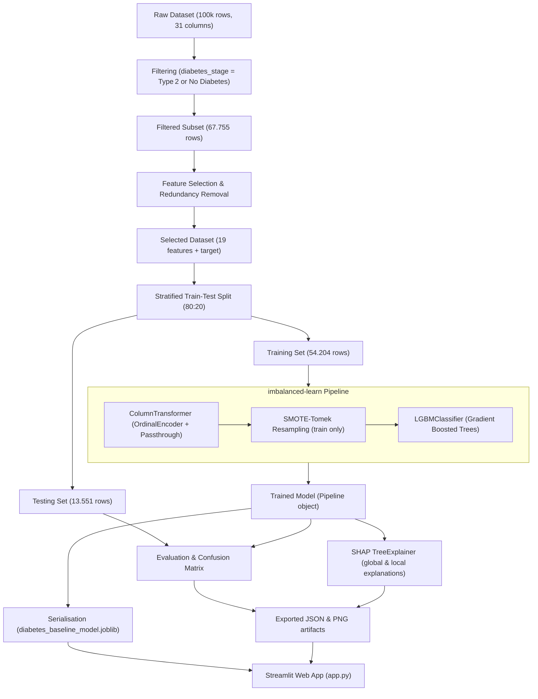

# DiabetesCare: Sistem Skrining & Prediksi Risiko Diabetes Melitus Tipe 2

Aplikasi web interaktif berbasis **Streamlit**, **LightGBM**, **imbalanced-learn (SMOTE‑Tomek)**, dan **Explainable AI (SHAP)** untuk memprediksi risiko **Diabetes Melitus Tipe 2** menggunakan 19 indikator klinis, laboratorium, riwayat medis, dan gaya hidup.

Proyek ini merupakan implementasi praktis dari riset Tugas Akhir (2025) yang menghubungkan model machine‑learning berpresisi tinggi dengan antarmuka klinis yang mudah dipahami.

---

## Table of Contents
- [1. Project Overview](#1-project-overview)
- [2. Architecture & Workflow](#2-architecture--workflow)
- [3. Methodology & Machine Learning Engineering](#3-methodology--machine-learning-engineering)
- [4. Evaluation Results](#4-evaluation-results)
- [5. Project Structure](#5-project-structure)
- [6. Features Used by the Model](#6-features-used-by-the-model)
- [7. Diagnostic Criteria (PERKENI & ADA)](#7-diagnostic-criteria-perkeni--ada)
- [8. Application Features & Navigation](#8-application-features--navigation)
- [9. Installation & Execution](#9-installation--execution)
- [10. Medical Disclaimer](#10-medical-disclaimer)
- [11. License & Contributions](#11-license--contributions)

---

## 1. Project Overview
**Background & Clinical Urgency**
- Diabetes Melitus Tipe 2 (DMT2) merupakan salah satu penyakit tidak menular dengan beban epidemiologis terbesar di dunia. Di Indonesia, lebih dari **19,5 juta** orang dewasa hidup dengan diabetes, menempatkan negara pada peringkat ke‑5 global.
- Lebih dari **50 %** penderita tidak mengetahui kondisi mereka pada fase awal karena gejala yang tidak spesifik, sehingga komplikasi jangka panjang (nefropati, retinopati, neuropati, penyakit kardiovaskular) sering terdeteksi terlambat.

**Tujuan Pengembangan**
1. Menyediakan alat skrining non‑invasif yang dapat memperkirakan probabilitas DMT2 secara cepat dan akurat.
2. Menyajikan interpretabilitas keputusan (SHAP) sehingga kontribusi tiap variabel dapat dipertanggungjawabkan secara klinis.
3. Menyampaikan edukasi preventif berbasis pedoman **PERKENI** dan **ADA** langsung dalam aplikasi.
4. Menyediakan arsitektur yang siap produksi (Docker‑containerized) untuk deployment mudah.

---

## 2. Architecture & Workflow
### 2.1 End‑to‑End Machine Learning Pipeline


### 2.2 Application Stack


---

## 3. Methodology & Machine Learning Engineering
**Dataset** – `data/diabetes_dataset.csv` (100 000 samples, 31 columns). After filtering, the modeling subset contains 67 755 rows.

**Feature Selection**
- Manual removal of socio‑economic variables (`ethnicity`, `education_level`, `income_level`, `employment_status`).
- Correlation‑based pruning (|r| ≥ 0.5) eliminated `waist_to_hip_ratio`, `systolic_bp`, `ldl_cholesterol`, `glucose_postprandial`, `hba1c`, and `diabetes_risk_score`.
- Final set: 19 clinically relevant features (2 categorical, 17 numeric).

**Class Imbalance Handling**
- Original training distribution: 6 385 (Non‑Diabetes) vs 47 819 (Diabetes).
- Applied **SMOTE‑Tomek** (`imblearn.combine.SMOTETomek`) inside an `imblearn.pipeline.Pipeline` so resampling occurs only on the training fold.

**Model** – `LGBMClassifier` (gradient‑boosted decision trees) with default hyper‑parameters (learning_rate = 0.1, n_estimators = 100, n_jobs = ‑1).

**Explainability** – SHAP (`shap.TreeExplainer`) providing:
- Global feature importance (gain & split).
- Local waterfall plots for individual predictions (True Positive & True Negative cases).

---

## 4. Evaluation Results
| Metric | Training Set (54 204) | Testing Set (13 551) |
|---|---|---|
| **Accuracy** | 95.50 % | 93.29 % |
| **Precision (Diabetes)** | 99.40 % | 98.08 % |
| **Recall (Diabetes)** | 95.47 % | 94.24 % |
| **F1‑Score (Diabetes)** | 97.40 % | 96.12 % |
| **ROC‑AUC** | 98.74 % | 97.15 % |
| **PR‑AUC** | 99.84 % | 99.64 % |

**Confusion Matrix (Testing)**
- True Negative (TN): 1 376
- True Positive (TP): 11 266
- False Positive (FP): 220 (≈ 1.6 % false‑alarm rate)
- False Negative (FN): 689 (≈ 5.1 % missed rate)

Detailed metrics and SHAP visualisations are stored in `exported/outputs/` (JSON) and `exported/plots/` (PNG).

---

## 5. Project Structure
```
diabetes_prediction/
├── data/                     # Raw dataset CSV
├── model/                    # Serialized pipeline (joblib)
├── notebooks/                # Jupyter notebook of the experiment
│   ├── TA2025-v3.ipynb
│   └── README.md
├── exported/
│   ├── outputs/              # JSON export of metrics & SHAP values
│   └── plots/                # PNG visualisations (EDA, evaluation, SHAP)
├── app.py                    # Streamlit application (3 pages)
├── train.py                  # Script to train the baseline model
├── Dockerfile                # Build image (Python 3.11‑slim)
├── docker-compose.yml        # Deploy container
├── requirements.txt          # Python dependencies
├── .dockerignore
├── .gitignore
└── README.md                 # Documentation (this file)
```

---

## 6. Features Used by the Model
| # | Feature | Category | Type | Description |
|---|---|---|---|---|
| 1 | `gender` | Demografi | Categorical | Female / Male / Other |
| 2 | `age` | Demografi | Numeric | 18 – 90 years |
| 3 | `smoking_status` | Gaya Hidup | Categorical | Never / Former / Current |
| 4 | `alcohol_consumption_per_week` | Gaya Hidup | Numeric | Units per week (0‑10) |
| 5 | `physical_activity_minutes_per_week` | Gaya Hidup | Numeric | Target ≥ 150 min/week |
| 6 | `diet_score` | Gaya Hidup | Numeric | 0 – 10 (higher = healthier) |
| 7 | `sleep_hours_per_day` | Gaya Hidup | Numeric | 7‑8 hours ideal |
| 8 | `screen_time_hours_per_day` | Gaya Hidup | Numeric | Hours in front of screen |
| 9 | `family_history_diabetes` | Riwayat Medis | Binary (0 = No, 1 = Yes) |
|10| `hypertension_history` | Riwayat Medis | Binary |
|11| `cardiovascular_history` | Riwayat Medis | Binary |
|12| `bmi` | Pengukuran Fisik | Numeric (kg/m²) |
|13| `diastolic_bp` | Pengukuran Fisik | Numeric (mmHg) |
|14| `heart_rate` | Pengukuran Fisik | Numeric (bpm) |
|15| `glucose_fasting` | Laboratorium | Numeric (mg/dL) |
|16| `insulin_level` | Laboratorium | Numeric (µU/mL) |
|17| `cholesterol_total` | Lipid | Numeric (mg/dL) |
|18| `hdl_cholesterol` | Lipid | Numeric (mg/dL) |
|19| `triglycerides` | Lipid | Numeric (mg/dL) |

---

## 7. Diagnostic Criteria (PERKENI & ADA)
| Parameter | Normal | Prediabetes | Diabetes |
|---|---|---|---|
| **Glukosa Puasa (GDP)** | < 100 mg/dL | 100 – 125 mg/dL | ≥ 126 mg/dL |
| **Glukosa 2 jam Postprandial (GD2PP)** | < 140 mg/dL | 140 – 199 mg/dL | ≥ 200 mg/dL |
| **HbA1c** | < 5.7 % | 5.7 – 6.4 % | ≥ 6.5 % |
| **Glukosa Sewaktu (GDS)** | < 140 mg/dL | 140 – 199 mg/dL | ≥ 200 mg/dL (dengan gejala) |

---

## 8. Application Features & Navigation
The Streamlit app uses **Top Navigation** (`st.navigation position="top"`) with three pages:
1. **Overview & Edukasi** – Clinical background, risk factors, prevention pillars, and diagnostic tables.
2. **Skrining Risiko** – Form split into three tabs (Demografi & Gaya Hidup, Riwayat Medis & Fisik, Laboratorium). Includes three preset buttons (Healthy, High‑Risk, Median) for quick testing. Results show probability, progress bar, warning notes for out‑of‑range biomarkers, and clinical recommendations.
3. **Model & Visualisasi** – Details of the serialized pipeline, evaluation metrics (loaded from JSON), and a gallery of nine visualisations (EDA, model performance, SHAP) with explanatory captions.

---

## 9. Installation & Execution
### Option A – Docker (Recommended)
```bash
sudo docker compose up --build -d   # Build and run in background
```
Access the app at **http://localhost:8501**.
To stop:
```bash
sudo docker compose down
```
### Option B – Manual Local Execution
```bash
# System dependencies (Ubuntu/Debian)
sudo apt update && sudo apt install -y python3-pip python3-venv libgomp1

# Virtual environment
python3 -m venv .venv
source .venv/bin/activate

# Python packages
pip install --upgrade pip
pip install -r requirements.txt

# Run the app
streamlit run app.py
```
The app will be available at **http://localhost:8501**.

---

## 10. Medical Disclaimer
**This tool is a predictive aid for educational and research purposes only.** It does not replace professional medical diagnosis, consultation, or treatment. High risk probabilities should prompt referral to qualified healthcare providers for confirmatory testing.

---

## 11. License & Contributions
The project is released under the MIT License. Contributions, issue reports, and pull requests are welcomed.
