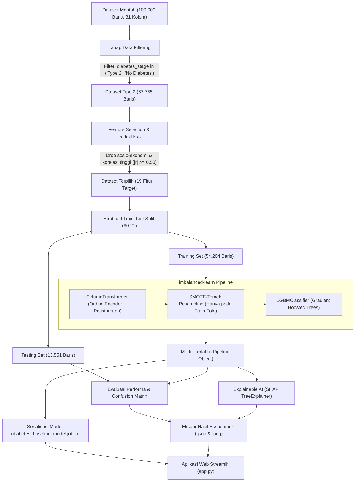
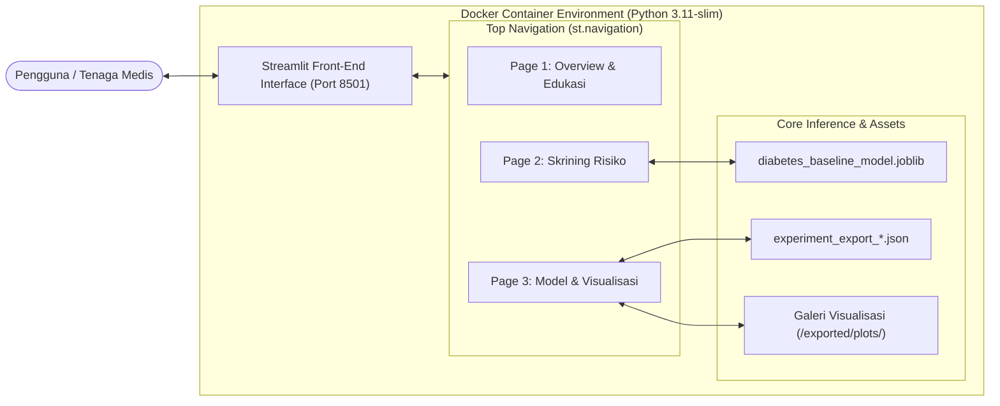
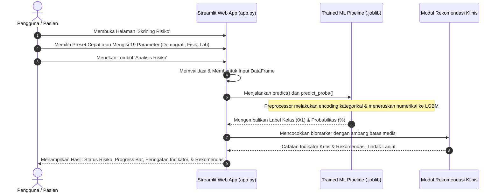

# 🩺 DiabetesCare: Sistem Skrining & Prediksi Risiko Diabetes Melitus Tipe 2

Aplikasi web cerdas, interaktif, dan komprehensif berbasis **Streamlit**, **LightGBM**, **imbalanced-learn (SMOTE-Tomek)**, dan **Explainable AI (SHAP)** untuk memprediksi potensi risiko **Diabetes Melitus Tipe 2 (DMT2)** berdasarkan 19 indikator klinis, biomarker laboratorium, riwayat medis, dan gaya hidup pasien. 

Proyek ini dikembangkan sebagai implementasi praktis dan diseminasi dari riset Tugas Akhir / Skripsi (2025), menjembatani model prediktif machine learning berkemampuan tinggi dengan antarmuka klinis yang mudah dipahami oleh tenaga kesehatan maupun masyarakat umum.

---

## 📌 Project Overview

### 1. Latar Belakang & Urgensi Klinis
Diabetes Melitus Tipe 2 merupakan salah satu penyakit tidak menular (PTM) dengan beban epidemiologis tertinggi di dunia. Di Indonesia, lebih dari **19,5 juta orang dewasa** hidup dengan kondisi diabetes, menempatkan Indonesia pada peringkat ke-5 global. Sayangnya, **lebih dari 50% penderita tidak menyadari kondisinya pada fase awal** karena gejala hiperglikemia kerap berkembang tanpa keluhan spesifik (silent killer). Keterlambatan deteksi memicu komplikasi fatal jangka panjang seperti nefropati diabetik, retinopati (kebutaan), neuropati perifer (amputasi), serta penyakit kardiovaskular.

### 2. Tujuan Pengembangan
* **Skrining Dini Berbasis Bukti:** Menyediakan instrumen skrining non-invasif dan biomarker awal guna mengestimasi probabilitas risiko diabetes tipe 2 secara cepat dan presisi.
* **Transparansi Keputusan (Explainable AI):** Mengikis paradigma *black-box* pada machine learning menggunakan metode SHAP (*SHapley Additive exPlanations*) sehingga kontribusi tiap variabel pasien dapat diverifikasi secara fisiologis.
* **Edukasi Preventif Terintegrasi:** Menyajikan materi edukasi klinis berdasarkan pedoman konsensus **PERKENI (Perkumpulan Endokrinologi Indonesia)** dan **ADA (American Diabetes Association)** langsung di dalam aplikasi.
* **Kesiapan Produksi (Production-Ready Architecture):** Mengemas pipeline data, model scikit-learn/imblearn, aset visualisasi, dan antarmuka Streamlit ke dalam kontainer Docker terisolasi dan mudah di-deploy.

---

## 🏗️ Arsitektur Sistem & Workflow

### 1. Alur Kerja Rekayasa Machine Learning (End-to-End ML Pipeline)
Diagram berikut menggambarkan siklus hidup data mulai dari pemrosesan dataset mentah hingga model siap pakai untuk inferensi:



---

### 2. Arsitektur Komponen Aplikasi Web
Diagram berikut menguraikan interaksi modular antara pengguna, antarmuka pengguna Streamlit, engine inferensi, dan kontainerisasi Docker:



---

### 3. Diagram Alur Inferensi Skrining Pengguna
Diagram berikut merinci langkah-langkah saat pengguna melakukan pengujian risiko diabetes:



---

## 🔬 Analisis Metodologi & Rekayasa Machine Learning

### 1. Karakteristik Dataset
* **Sumber Data:** Dataset sintetis representatif riil skala besar (`diabetes_dataset.csv`) berjumlah **100.000 sampel** dan **31 variabel**.
* **Filtering Target Subpopulasi:** Dari klasifikasi awal multiclass (`diabetes_stage`), riset difokuskan spesifik pada deteksi **Diabetes Melitus Tipe 2**. Data difilter hanya mencakup sampel bertipe `'Type 2'` dan `'No Diabetes'`, menghasilkan subpopulasi sebanyak **67.755 baris**.

### 2. Feature Selection & Penanganan Multikolinearitas
Untuk membangun model yang efisien (*parsimonious*), stabil, dan bebas dari distorsi multikolinearitas, dilakukan dua tahap eliminasi fitur:
1. **Eliminasi Manual Sosio-Ekonomi:** Variabel non-fisiologis yang tidak memiliki relevansi etiologis langsung terhadap resistensi insulin dieliminasi (`ethnicity`, `education_level`, `income_level`, `employment_status`).
2. **Eliminasi Berbasis Korelasi Pearson ($|r| \ge 0.50$):** Menghilangkan variabel yang redundan terhadap fitur penanda utama.
   * `waist_to_hip_ratio` dieliminasi (redundansi dengan `bmi`).
   * `systolic_bp` dieliminasi (diwakili oleh `diastolic_bp`).
   * `ldl_cholesterol` dieliminasi (diwakili oleh `cholesterol_total`, `hdl_cholesterol`, dan `triglycerides`).
   * `glucose_postprandial`, `hba1c`, dan `diabetes_risk_score` dieliminasi dari training untuk menguji kekuatan prediktif parameter non-invasif dan glukosa puasa standar tanpa bergantung pada skor komposit yang berpotensi *data leakage*.

### 3. Penanganan Ketimpangan Kelas (Class Imbalance)
Distribusi kelas target pada data training menunjukkan ketimpangan signifikan:
* **Kelas 0 (Non-Diabetes):** 6.385 sampel (~11.8%)
* **Kelas 1 (Diabetes Tipe 2):** 47.819 sampel (~88.2%)

Untuk mengatasi bias prediksi terhadap kelas mayoritas, diterapkan teknik kombinasi **SMOTE-Tomek** (`imblearn.combine.SMOTETomek`):
* **SMOTE (Synthetic Minority Over-sampling Technique):** Membangkitkan sampel sintetis kelas minoritas (Non-Diabetes) pada ruang fitur menggunakan k-nearest neighbors.
* **Tomek Links:** Mengidentifikasi dan menghapus pasangan sampel antar-kelas yang saling berdekatan di batas keputusan untuk mempertajam margin pemisah (*decision boundary cleaning*).
* **Pencegahan Data Leakage:** SMOTE-Tomek diintegrasikan secara ketat di dalam objek `imblearn.pipeline.Pipeline`, sehingga proses *resampling* **hanya berlangsung pada subset data latih (training fold)** dan secara otomatis dilewati (*bypassed*) saat mode inferensi/testing.

### 4. Algoritma Pemodelan: LightGBM (Light Gradient Boosting Machine)
Model klasifikasi menggunakan `LGBMClassifier` dengan keunggulan:
* Pendekatan pertumbuhan pohon berbasis daun (*leaf-wise tree growth*) dengan kedalaman dinamis, menghasilkan akurasi lebih tinggi dibanding *level-wise*.
* Efisiensi memori dan kecepatan pelatihan tinggi menggunakan algoritma berbasis histogram.
* Dukungan bawaan untuk fitur biner dan kategorikal terordinalisasi.

### 5. Explainable AI (SHAP / TreeExplainer)
Menggunakan **SHAP** (*SHapley Additive exPlanations*) untuk menyediakan interpretabilitas global dan lokal:
* **Global Importance:** Menunjukkan bahwa **Kadar Glukosa Puasa (`glucose_fasting`)** merupakan prediktor nomor satu dengan kontribusi marginal tertinggi terhadap risiko diabetes, diikuti oleh kebiasaan merokok (`smoking_status`), konsumsi alkohol (`alcohol_consumption_per_week`), usia (`age`), riwayat hipertensi (`hypertension_history`), dan indeks massa tubuh (`bmi`).
* **Local Waterfall Analysis:** Setiap prediksi individual dapat dilacak jejak perhitungannya dari nilai dasar (*base value log-odds*) hingga probabilitas akhir, menjamin transparansi klinis.

---

## 📊 Hasil Evaluasi & Performa Model

Evaluasi model baseline pipeline pada data uji independen (**Testing Set = 13.551 sampel**) yang tidak pernah dilihat sebelumnya menghasilkan performa sebagai berikut:

| Metrik Evaluasi | Training Set (54.204 sampel) | Testing Set (13.551 sampel) | Catatan Klinis |
| :--- | :---: | :---: | :--- |
| **Akurasi** | **95.50%** | **93.29%** | Tingkat ketepatan klasifikasi keseluruhan |
| **Presisi (Kelas 1)** | **99.40%** | **98.08%** | Meminimalkan rujukan salah (*false alarm*) |
| **Recall (Kelas 1)** | **95.47%** | **94.24%** | Meminimalkan pasien diabetes yang terlewat |
| **F1-Score (Kelas 1)** | **97.40%** | **96.12%** | Keseimbangan harmonis antara presisi dan sensitivitas |
| **ROC-AUC** | **98.74%** | **97.15%** | Kemampuan diskriminasi antar-kelas sangat unggul |
| **PR-AUC** | **99.84%** | **99.64%** | Ketangguhan model pada distribusi data terstratifikasi |

### Rincian Confusion Matrix (Testing Set = 13.551 Pasien)
* **True Negative (TN):** `1.376` pasien sehat diklasifikasikan normal dengan tepat.
* **True Positive (TP):** `11.266` pasien diabetes teridentifikasi positif dengan akurat.
* **False Positive (FP):** `220` pasien sehat terindikasi positif (false alarm rate rendah: ~1.6%).
* **False Negative (FN):** `689` pasien diabetes terlewat (missed rate: ~5.1%).

---

## 📁 Struktur Folder Proyek

Berikut adalah hierarki lengkap direktori proyek beserta penjelasan fungsional setiap komponennya:

```text
diabetes_prediction/
├── data/
│   └── diabetes_dataset.csv              # Dataset mentah 100.000 baris x 31 kolom
├── model/
│   └── diabetes_baseline_model.joblib    # Serialisasi Pipeline ML terlatih (LightGBM + Preprocessor)
├── notebooks/
│   ├── TA2025-v3.ipynb                   # Jupyter Notebook eksperimen riset (EDA, Seleksi, SMOTE, LightGBM, SHAP)
│   └── README.md                         # Catatan dan panduan folder eksperimen
├── exported/
│   ├── outputs/
│   │   └── experiment_export_*.json      # Metadata metrik evaluasi, parameter model, dan nilai SHAP
│   └── plots/
│       ├── 01_numerical_features_boxplots.png         # Boxplot sebaran & deteksi outlier
│       ├── 02_numerical_features_distributions.png    # Histogram & kurva KDE fitur numerik
│       ├── 03_correlation_heatmap.png                 # Heatmap korelasi matriks Pearson
│       ├── 04_lgbm_feature_importance.png             # Tingkat kepentingan fitur LightGBM (gain/split)
│       ├── 05_confusion_matrices.png                  # Matriks konfusi train vs test set
│       ├── 06_shap_beeswarm.png                       # Ringkasan dampak fitur global SHAP beeswarm
│       ├── 07_shap_feature_importance_bar.png         # Bar plot rata-rata bobot mutlak SHAP
│       ├── 08_shap_waterfall_true_positive.png        # Dekomposisi keputusan kasus True Positive
│       └── 09_shap_waterfall_true_negative.png        # Dekomposisi keputusan kasus True Negative
├── app.py                                # Aplikasi web Streamlit utama (Top Navigation, 3 Halaman)
├── train.py                              # Script pelatihan independen pipeline LightGBM
├── Dockerfile                            # Instruksi build image container (Python 3.11-slim + OpenMP)
├── docker-compose.yml                    # Konfigurasi deployment container dan volume mounting
├── requirements.txt                      # Daftar dependensi library Python
├── .dockerignore                         # Pengabaian file non-esensial saat build Docker
├── .gitignore                            # Pengabaian file lokal, cache, dan virtual environment
└── README.md                             # Dokumentasi komprehensif proyek
```

---

## 🔬 19 Fitur yang Digunakan Model

Model memanfaatkan 19 variabel input yang dikelompokkan ke dalam 3 kategori klinis:

| No | Nama Fitur | Kategori | Tipe Data | Deskripsi & Rentang Normal |
| :---: | :--- | :--- | :---: | :--- |
| 1 | `gender` | Demografi | Kategorikal | Jenis kelamin pasien (*Female, Male, Other*) |
| 2 | `age` | Demografi | Numerik | Usia pasien (18 – 90 tahun) |
| 3 | `smoking_status` | Gaya Hidup | Kategorikal | Riwayat tembakau (*Never, Former, Current*) |
| 4 | `alcohol_consumption_per_week` | Gaya Hidup | Numerik | Porsi minuman beralkohol per minggu (0 – 10) |
| 5 | `physical_activity_minutes_per_week` | Gaya Hidup | Numerik | Aktivitas fisik aerobik per minggu (Target: $\ge$ 150 menit) |
| 6 | `diet_score` | Gaya Hidup | Numerik | Indeks kualitas pola makan seimbang (Skor 0.0 – 10.0) |
| 7 | `sleep_hours_per_day` | Gaya Hidup | Numerik | Durasi istirahat malam per hari (Ideal: 7 – 8 jam) |
| 8 | `screen_time_hours_per_day` | Gaya Hidup | Numerik | Waktu di depan layar per hari (jam/hari) |
| 9 | `family_history_diabetes` | Riwayat Medis | Biner | Riwayat diabetes pada keluarga tingkat pertama (0 = Tidak, 1 = Ada) |
| 10 | `hypertension_history` | Riwayat Medis | Biner | Diagnosis riwayat tekanan darah tinggi (0 = Tidak, 1 = Ada) |
| 11 | `cardiovascular_history` | Riwayat Medis | Biner | Riwayat gangguan kardiovaskular / jantung (0 = Tidak, 1 = Ada) |
| 12 | `bmi` | Pengukuran Fisik | Numerik | Indeks Massa Tubuh (kg/m²). Normal Asia-Pasifik: 18.5 – 22.9 |
| 13 | `diastolic_bp` | Pengukuran Fisik | Numerik | Tekanan darah diastolik (mmHg). Batas normal: < 80 mmHg |
| 14 | `heart_rate` | Pengukuran Fisik | Numerik | Frekuensi denyut nadi istirahat (Normal: 60 – 100 bpm) |
| 15 | `glucose_fasting` | Biomarker Lab | Numerik | Glukosa Darah Puasa (mg/dL). Normal: < 100 mg/dL |
| 16 | `insulin_level` | Biomarker Lab | Numerik | Kadar insulin puasa ($\mu\text{U/mL}$). Normal: 2 – 20 $\mu\text{U/mL}$ |
| 17 | `cholesterol_total` | Profil Lipid | Numerik | Kolesterol total serum (mg/dL). Ideal: < 200 mg/dL |
| 18 | `hdl_cholesterol` | Profil Lipid | Numerik | Kolesterol HDL (mg/dL). Protektif: > 50 mg/dL |
| 19 | `triglycerides` | Profil Lipid | Numerik | Trigliserida darah (mg/dL). Normal: < 150 mg/dL |

---

## 🩺 Kriteria Acuan Diagnostik Medis (PERKENI & ADA)

Sebagai referensi klinis yang tertanam pada halaman edukasi aplikasi, berikut adalah acuan batas diagnosis diabetes:

| Parameter Pemeriksaan | Normal | Prediabetes | Diabetes Melitus |
| :--- | :---: | :---: | :---: |
| **Glukosa Darah Puasa (GDP)** | < 100 mg/dL | 100 – 125 mg/dL | $\ge$ 126 mg/dL |
| **Glukosa 2 Jam Postprandial (GD2PP)** | < 140 mg/dL | 140 – 199 mg/dL | $\ge$ 200 mg/dL |
| **HbA1c (Hemoglobin Terglikasi)** | < 5.7 % | 5.7 – 6.4 % | $\ge$ 6.5 % |
| **Glukosa Darah Sewaktu (GDS)** | < 140 mg/dL | 140 – 199 mg/dL | $\ge$ 200 mg/dL *(dengan gejala klasik)* |

---

## 💻 Fitur & Navigasi Aplikasi Web Streamlit

Aplikasi dirancang dengan antarmuka modern menggunakan **Top Navigation Bar** (`st.navigation position="top"`) yang membagi pengalaman pengguna ke dalam 3 menu terstruktur:

1. **Overview & Edukasi:**
   * Tinjauan patofisiologi Diabetes Melitus Tipe 1, Tipe 2, Prediabetes, dan Gestasional.
   * Faktor risiko bawaan (non-modifikasi) vs faktor gaya hidup (dapat dimodifikasi).
   * 6 pilar pencegahan primer dan tabel kriteria diagnostik resmi PERKENI/ADA.
2. **Skrining Risiko:**
   * **Preset Input Cepat:** Tiga tombol instan (*Pasien Sehat*, *Pasien Berisiko Tinggi*, *Reset Nilai Rata-rata/Median*) untuk kemudahan pengujian form.
   * **Formulir Terbagi dalam 3 Tab:** Memudahkan pengisian data tanpa membuat halaman terlalu panjang.
   * **Hasil Analisis Cerdas:** Menampilkan probabilitas numerik, visualisasi progress bar, deteksi indikator kritis (misal: GDP $\ge$ 126 mg/dL atau obesitas), dan rekomendasi tindak lanjut medis.
3. **Model & Visualisasi:**
   * **Spesifikasi Pipeline `.joblib`:** Informasi detail arsitektur encoder, resampler, dan classifier.
   * **Metrik Riil:** Menampilkan perbandingan metrik evaluasi training vs testing secara dinamis dari file JSON `exported/outputs/`.
   * **Galeri Visualisasi Teranotasi:** Menampilkan 9 grafik visualisasi eksperimen (`exported/plots/`) yang dikelompokkan ke dalam tab EDA, Evaluasi Model, dan Explainable AI (SHAP) lengkap dengan narasi analisis data.

---

## 🐳 Panduan Instalasi & Eksekusi

### Opsi 1: Menjalankan dengan Docker & Docker Compose (Direkomendasikan)
Metode ini adalah opsi paling praktis, terisolasi, dan bebas dari isu kompatibilitas dependensi sistem.

1. **Jalankan container di latar belakang:**
   ```bash
   sudo docker compose up --build -d
   ```
2. **Akses aplikasi di browser web:**
   👉 **`http://localhost:8501`**
3. **Melihat log container (opsional):**
   ```bash
   sudo docker compose logs -f
   ```
4. **Menghentikan container:**
   ```bash
   sudo docker compose down
   ```

---

### Opsi 2: Menjalankan Secara Manual (Lokal Python Virtualenv)

1. **Prasyarat Sistem (Linux Ubuntu/Debian):**
   ```bash
   sudo apt update
   sudo apt install -y python3-pip python3-venv libgomp1
   ```
   *(Catatan: Paket `libgomp1` diperlukan oleh OpenMP untuk menjalankan LightGBM)*.

2. **Buat dan aktifkan Virtual Environment:**
   ```bash
   python3 -m venv .venv
   source .venv/bin/activate
   ```

3. **Pasang Dependensi:**
   ```bash
   pip install --upgrade pip
   pip install -r requirements.txt
   ```

4. **Jalankan Aplikasi Streamlit:**
   ```bash
   streamlit run app.py
   ```
   Aplikasi akan otomatis terbuka pada port `http://localhost:8501`.

---

### Opsi 3: Melatih Ulang Model Pipeline (`train.py`)
Jika Anda ingin melatih ulang model menggunakan dataset yang diperbarui atau mengubah konfigurasi pipeline:
```bash
python3 train.py
```
Script akan membaca `data/diabetes_dataset.csv`, melakukan proses pemfilteran, melatih pipeline `SMOTETomek + LGBMClassifier`, mengevaluasi test set, dan memperbarui file model di `model/diabetes_baseline_model.joblib`.

---

## ⚠️ Medical Disclaimer

> **Pernyataan Penyangkalan Medis (Medical Disclaimer):**  
> Sistem skrining ini merupakan instrumen prediktif berbasis komputasi kecerdasan buatan (*Machine Learning*) yang ditujukan untuk **tujuan edukasi, penelitian, dan pendukung keputusan skrining awal (skrining preventif)**. Sistem ini **TIDAK** menggantikan pemeriksaan medis profesional, diagnosis klinis formal, maupun saran dari dokter berlisensi. Hasil probabilitas tinggi mengindikasikan perlunya konsultasi lanjutan ke fasilitas pelayanan kesehatan terdekat.

---

## 📄 Lisensi & Kontribusi
Proyek ini dikembangkan untuk tujuan edukasi akademik dan penelitian open-source. Kontribusi, pelaporan bug (*issue*), serta usulan fitur baru sangat terbuka melalui mekanisme *Pull Request*.
