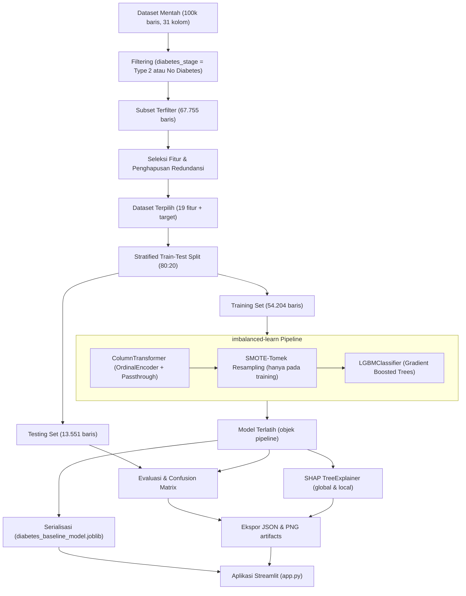
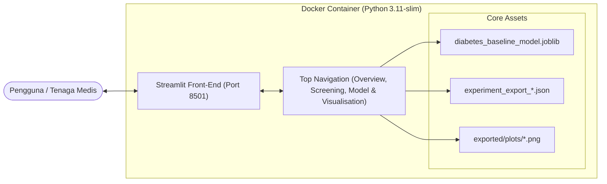

# DiabetesCare: Sistem Skrining & Prediksi Risiko Diabetes Melitus Tipe 2

Aplikasi web interaktif berbasis **Streamlit**, **LightGBM**, **imbalanced‑learn (SMOTE‑Tomek)**, dan **Explainable AI (SHAP)** untuk memprediksi risiko **Diabetes Melitus Tipe 2** menggunakan 19 indikator klinis, laboratorium, riwayat medis, dan gaya hidup.

Proyek ini merupakan implementasi praktis dari riset Tugas Akhir (2025) yang menghubungkan model machine‑learning berpresisi tinggi dengan antarmuka klinis yang mudah dipahami.

---

## Daftar Isi
- [1. Ringkasan Proyek](#1-ringkasan-proyek)
- [2. Arsitektur & Alur Kerja](#2-arsitektur--alur-kerja)
- [3. Metodologi & Rekayasa Machine Learning](#3-metodologi--rekayasa-machine-learning)
- [4. Hasil Evaluasi](#4-hasil-evaluasi)
- [5. Struktur Proyek](#5-struktur-proyek)
- [6. Fitur yang Digunakan Model](#6-fitur-yang-digunakan-model)
- [7. Kriteria Diagnostik (PERKENI & ADA)](#7-kriteria-diagnostik-perkeni--ada)
- [8. Fitur Aplikasi & Navigasi](#8-fitur-aplikasi--navigasi)
- [9. Instalasi & Eksekusi](#9-instalasi--eksekusi)
- [10. Penyangkalan Medis](#10-penyangkalan-medis)

---

## 1. Ringkasan Proyek
**Latar Belakang & Urgensi Klinis**
- Diabetes Melitus Tipe 2 (DMT2) merupakan salah satu penyakit tidak menular dengan beban epidemiologis terbesar di dunia. Di Indonesia, lebih dari **19,5 juta** orang dewasa hidup dengan diabetes, menempatkan negara pada peringkat ke‑5 secara global.
- Lebih dari **50 %** penderita tidak mengetahui kondisi mereka pada fase awal karena gejala yang tidak spesifik, sehingga komplikasi jangka panjang (nefropati, retinopati, neuropati, penyakit kardiovaskular) sering terdeteksi terlambat.

**Tujuan Pengembangan**
1. Menyediakan alat skrining non‑invasif yang dapat memperkirakan probabilitas DMT2 secara cepat dan akurat.
2. Menyajikan interpretabilitas keputusan (SHAP) sehingga kontribusi tiap variabel dapat dipertanggungjawabkan secara klinis.
3. Menyampaikan edukasi preventif berbasis pedoman **PERKENI** dan **ADA** langsung dalam aplikasi.
4. Menyediakan arsitektur yang siap produksi (Docker‑containerized) untuk deployment mudah.

---

## 2. Arsitektur & Alur Kerja
### 2.1 Pipeline Machine Learning End‑to‑End


### 2.2 Stack Aplikasi


---

## 3. Metodologi & Rekayasa Machine Learning
**Dataset** – `data/diabetes_dataset.csv` (100 000 sampel, 31 kolom). Setelah difilter, subset yang dipakai berjumlah 67 755 baris.

**Seleksi Fitur**
- Penghapusan manual variabel sosio‑ekonomi: `ethnicity`, `education_level`, `income_level`, `employment_status`.
- Pruning berbasis korelasi (|r| ≥ 0.5) mengeliminasi `waist_to_hip_ratio`, `systolic_bp`, `ldl_cholesterol`, `glucose_postprandial`, `hba1c`, dan `diabetes_risk_score`.
- Hasil akhir: 19 fitur klinis (2 kategorikal, 17 numerik).

**Penanganan Ketidakseimbangan Kelas**
- Distribusi asli pada data latih: 6 385 (Non‑Diabetes) vs 47 819 (Diabetes).
- Diterapkan **SMOTE‑Tomek** (`imblearn.combine.SMOTETomek`) dalam `imblearn.pipeline.Pipeline` sehingga resampling hanya terjadi pada data training.

**Model** – `LGBMClassifier` (gradient‑boosted decision trees) dengan parameter standar (learning_rate = 0.1, n_estimators = 100, n_jobs = ‑1).

**Explainability** – SHAP (`shap.TreeExplainer`) memberikan:
- Pentingnya fitur secara global (gain & split).
- Waterfall plot lokal untuk masing‑masing prediksi (True Positive & True Negative).

---

## 4. Hasil Evaluasi
| Metrik | Training Set (54 204) | Testing Set (13 551) |
|---|---|---|
| **Akurasi** | 95,50 % | 93,29 % |
| **Presisi (Diabetes)** | 99,40 % | 98,08 % |
| **Recall (Diabetes)** | 95,47 % | 94,24 % |
| **F1‑Score (Diabetes)** | 97,40 % | 96,12 % |
| **ROC‑AUC** | 98,74 % | 97,15 % |
| **PR‑AUC** | 99,84 % | 99,64 % |

**Confusion Matrix (Testing)**
- True Negative (TN): 1 376
- True Positive (TP): 11 266
- False Positive (FP): 220 (≈ 1,6 % false‑alarm rate)
- False Negative (FN): 689 (≈ 5,1 % missed rate)

Metrik terperinci dan visualisasi SHAP tersimpan di `exported/outputs/` (JSON) serta `exported/plots/` (PNG).

---

## 5. Struktur Proyek
```
diabetes_prediction/
├── data/                     # Dataset mentah CSV
├── model/                    # Pipeline terserialisasi (joblib)
├── notebooks/                # Notebook Jupyter percobaan
│   ├── TA2025-v3.ipynb
│   └── README.md
├── exported/
│   ├── outputs/              # Ekspor JSON metrik & nilai SHAP
│   └── plots/                # Visualisasi PNG (EDA, evaluasi, SHAP)
├── app.py                    # Aplikasi Streamlit (3 halaman)
├── train.py                  # Skrip pelatihan model baseline
├── Dockerfile                # File build image (Python 3.11‑slim)
├── docker-compose.yml        # Deploy container
├── requirements.txt          # Dependensi Python
├── .dockerignore
├── .gitignore
└── README.md                 # Dokumentasi (dokumen ini)
```

---

## 6. Fitur yang Digunakan Model
| No | Fitur | Kategori | Tipe | Deskripsi |
|---|---|---|---|---|
| 1 | `gender` | Demografi | Kategorikal | Female / Male / Other |
| 2 | `age` | Demografi | Numerik | 18 – 90 tahun |
| 3 | `smoking_status` | Gaya Hidup | Kategorikal | Never / Former / Current |
| 4 | `alcohol_consumption_per_week` | Gaya Hidup | Numerik | Unit per minggu (0‑10) |
| 5 | `physical_activity_minutes_per_week` | Gaya Hidup | Numerik | Target ≥ 150 menit/minggu |
| 6 | `diet_score` | Gaya Hidup | Numerik | 0 – 10 (lebih tinggi = lebih sehat) |
| 7 | `sleep_hours_per_day` | Gaya Hidup | Numerik | 7‑8 jam ideal |
| 8 | `screen_time_hours_per_day` | Gaya Hidup | Numerik | Jam di depan layar |
| 9 | `family_history_diabetes` | Riwayat Medis | Biner (0 = Tidak, 1 = Ya) |
|10| `hypertension_history` | Riwayat Medis | Biner |
|11| `cardiovascular_history` | Riwayat Medis | Biner |
|12| `bmi` | Pengukuran Fisik | Numerik (kg/m²) |
|13| `diastolic_bp` | Pengukuran Fisik | Numerik (mmHg) |
|14| `heart_rate` | Pengukuran Fisik | Numerik (bpm) |
|15| `glucose_fasting` | Laboratorium | Numerik (mg/dL) |
|16| `insulin_level` | Laboratorium | Numerik (µU/mL) |
|17| `cholesterol_total` | Lipid | Numerik (mg/dL) |
|18| `hdl_cholesterol` | Lipid | Numerik (mg/dL) |
|19| `triglycerides` | Lipid | Numerik (mg/dL) |

---

## 7. Kriteria Diagnostik (PERKENI & ADA)
| Parameter | Normal | Prediabetes | Diabetes |
|---|---|---|---|
| **Glukosa Puasa (GDP)** | < 100 mg/dL | 100 – 125 mg/dL | ≥ 126 mg/dL |
| **Glukosa 2 jam Postprandial (GD2PP)** | < 140 mg/dL | 140 – 199 mg/dL | ≥ 200 mg/dL |
| **HbA1c** | < 5,7 % | 5,7 – 6,4 % | ≥ 6,5 % |
| **Glukosa Sewaktu (GDS)** | < 140 mg/dL | 140 – 199 mg/dL | ≥ 200 mg/dL (dengan gejala) |

---

## 8. Fitur Aplikasi & Navigasi
Aplikasi Streamlit menggunakan **Top Navigation** (`st.navigation position="top"`) dengan tiga halaman:
1. **Overview & Edukasi** – Latar belakang klinis, faktor risiko, pilar pencegahan, serta tabel kriteria diagnostik.
2. **Skrining Risiko** – Form dibagi menjadi tiga tab (Demografi & Gaya Hidup, Riwayat Medis & Fisik, Laboratorium). Terdapat tiga tombol preset (Healthy, High‑Risk, Median) untuk mengisi data secara cepat. Hasil menampilkan probabilitas, progress bar, peringatan biomarker di luar batas, dan rekomendasi klinis.
3. **Model & Visualisasi** – Detail pipeline yang diserialisasi, metrik evaluasi (diimpor dari JSON), serta galeri sembilan visualisasi (EDA, performa model, SHAP) dengan keterangan.

---

## 9. Instalasi & Eksekusi
### Opsi A – Docker (Direkomendasikan)
```bash
sudo docker compose up --build -d   # Bangun dan jalankan di background
```
Untuk menghentikan container:
```bash
sudo docker compose down
```

### Opsi B – Eksekusi Lokal Manual
```bash
# Dependensi sistem (Ubuntu/Debian)
sudo apt update && sudo apt install -y python3-pip python3-venv libgomp1

# Lingkungan virtual
python3 -m venv .venv
source .venv/bin/activate

# Paket Python
pip install --upgrade pip
pip install -r requirements.txt

# Jalankan aplikasi
streamlit run app.py
```

---

## 10. Penyangkalan Medis
**Alat ini hanya bersifat bantuan prediksi untuk tujuan edukasi dan penelitian.** Tidak menggantikan diagnosis medis profesional, konsultasi, atau perawatan. Probabilitas risiko tinggi harus menjadi indikasi untuk merujuk ke tenaga kesehatan yang berwenang guna melakukan pemeriksaan konfirmatori.

---
